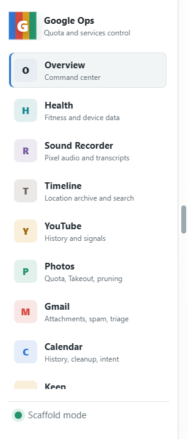
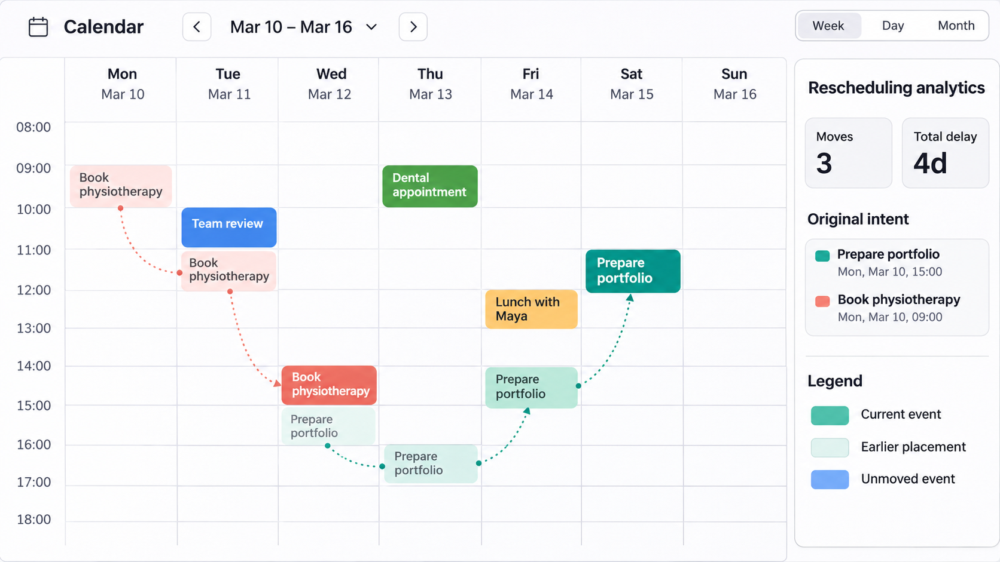
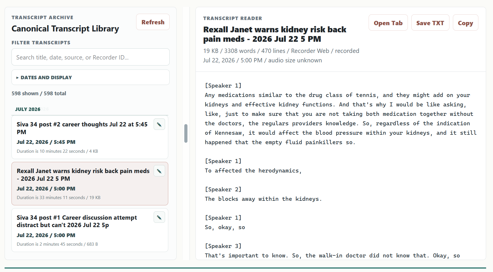
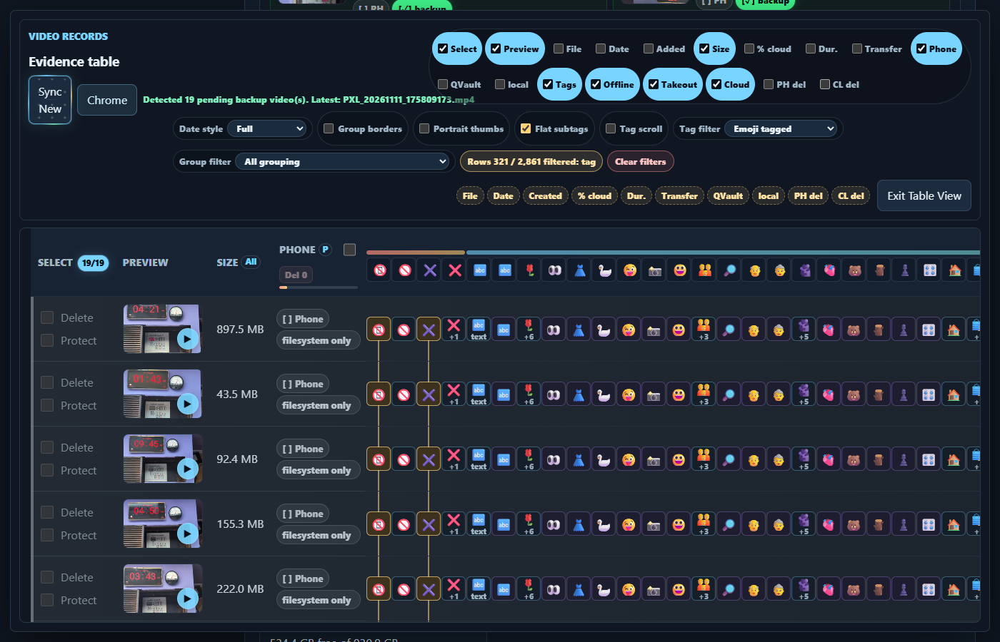

# Google Operations Dashboard

<p align="center"></p>

A local-first dashboard for managing Google-related archives and workflows. The application centralizes service portals while keeping credentials, account records, health data, location history, recordings, and generated inventories outside the public source tree.

> **Publication status:** This public documentation preview intentionally omits application source and machine-specific operational notes while the first sanitized source release is prepared.

## Modules

| Module | Status | Documentation |
| --- | --- | --- |
| Health | Active | [Health overview](docs/health/README.md) |
| Sound Recorder | Active | [Recorder overview](docs/sound-recorder/README.md) |
| Timeline | Active prototype | [Timeline overview](docs/timeline/README.md) |
| YouTube | External project* | [Hub assessment](docs/reports/youtube-project-assessment.md) · [Standalone repository](https://github.com/nastajus/yt-watch-audit) |
| Photos and Video | External project* | [Project assessment](docs/reports/photos-video-project-assessment.md) |
| Gmail | Concept | Planned |
| Calendar | Idea | [Calendar concept](docs/calendar/README.md) |
| Keep | Concept | Planned |
| Tasks | Concept | Planned |
| Drive | TBD | TBD |

\* Exists as an independent project and is intended to be folded into the Hub in some form; the integration boundary is not settled.

**YouTube documentation:** The [Hub assessment](docs/reports/youtube-project-assessment.md) is the concise, image-led overview of the module and its place in this multi-service dashboard. The standalone [YouTube History Dashboard README](https://github.com/nastajus/yt-watch-audit#readme) is the more detailed technical and operational reference. They describe the same external project at different levels of granularity and may be consolidated if the codebases are merged later.

See the [documentation index](docs/README.md) for the intended public documentation structure.

## Intended Outcomes

- **Health:** retrieve Google Health data into a private local archive and make movement, sleep, device status, gaps, and long-term patterns explorable.
- **Sound Recorder:** synchronize Recorder Web transcripts as the authoritative archive, retain audio when requested, and reconcile phone or Drive exports as fallback evidence.
- **Timeline:** centralize per-phone Google Maps Timeline exports and restore searchable PC map browsing across devices.
- **Photos and Video:** review related media in batches, preserve permanent offline copies, and turn visual tagging into guarded phone and cloud cleanup queues that save repeated manual work.
- **Gmail:** analyze roughly two decades of accumulated mail, identify spam and sender patterns, remove low-value bulk mail safely, and work toward zero unread.
- **Calendar:** turn an immutable audit trail of event movement into metrics and long-term trends, revealing which types of self-directed commitments are repeatedly deferred, completed, abandoned, or protected by external deadlines.
- **Keep:** recover an overgrown note archive by inventorying labels and cards, organizing useful material, and making deliberate archive or purge decisions.
- **Tasks:** provide a lightweight queue for overdue obligations, recurring work, and actions discovered in other modules.
- **YouTube:** turn watch-history and live ActivityWatch evidence into interactive calendars, heatmaps, trends, and real-time feedback about viewing behavior.
- **Drive:** remain a low-priority utility area until a useful workflow beyond bulk inventory and transfer is defined.

## Interface Preview



<details>
<summary>Module feature previews</summary>

| Module | Core interface |
| --- | --- |
| Timeline |  |
| Calendar concept |  |
| Sound Recorder |  |
| Photos and Video |  |
| Photos and Video detail |  |
| YouTube history |  |
| YouTube day detail |  |
| YouTube burstiness |  |

</details>

Feature screenshots are selected individually. Personal examples are included only when explicitly approved; other modules remain without screenshots until a representative view has been reviewed.

## Run

Install the browser-automation dependency once:

```powershell
npm install
```

Double-click `launch-dashboard.cmd`, or run:

```powershell
.\launch-dashboard.ps1
```

The launcher starts the local server and opens `http://127.0.0.1:8787/google/` in Firefox when available.

## Repository Layout

```text
assets/        Browser application code and styling
config/        Generic example configuration only
docs/          Public project and module documentation
scripts/       Local sync, import, analysis, and automation tools
data/          Private generated records; ignored
local/         Private browser profiles and working state; ignored
secrets/       OAuth clients and tokens; ignored
```

## Privacy And Publication

The repository is designed around a public-code/private-data boundary, but the current working history should be audited and sanitized before its first public push. Credentials, health records, location exports, transcripts, audio, account inventories, and private reports must never be committed.

See [PRIVACY.md](PRIVACY.md) for the data boundary. The dashboard also contains a local developer-facing privacy report under **Reports**.

