# Google Operations Dashboard

<p align="center"></p>

A local-first dashboard for managing Google-related archives and workflows. The application centralizes service portals while keeping credentials, account records, health data, location history, recordings, and generated inventories outside the public source tree.

> **Publication status:** This public documentation preview intentionally omits application source and machine-specific operational notes while the first sanitized source release is prepared.

## Modules

| Module | Status | Documentation |
| --- | --- | --- |
| Health | Active | [Health overview](docs/health/README.md) |
| Sound Recorder | Active | [Recorder overview](docs/sound-recorder/README.md) |
| Timeline | Prototype | Public documentation planned |
| Photos and Video | External project | [Project assessment](docs/reports/photos-video-project-assessment.md) |
| Gmail | Concept | Planned |
| Calendar | Prototype | Planned |
| Keep | Concept | Planned |
| Tasks | Scaffold | Planned |
| YouTube | External project | [Project assessment](docs/reports/youtube-project-assessment.md) |
| Drive | Utilities | Public documentation planned |

See the [documentation index](docs/README.md) for the intended public documentation structure.

## Intended Outcomes

- **Health:** retrieve Google Health data into a private local archive and make movement, sleep, device status, gaps, and long-term patterns explorable.
- **Sound Recorder:** synchronize Recorder Web transcripts as the authoritative archive, retain audio when requested, and reconcile phone or Drive exports as fallback evidence.
- **Timeline:** centralize per-phone Google Maps Timeline exports and restore searchable PC map browsing across devices.
- **Photos and Video:** manage constrained cloud storage through offline evidence, Takeout reconciliation, similarity review, and guarded deletion queues.
- **Gmail:** analyze roughly two decades of accumulated mail, identify spam and sender patterns, remove low-value bulk mail safely, and work toward zero unread.
- **Calendar:** preserve an audit trail of intended event placement and every reschedule so repeated delay, avoidance, and intent-versus-action patterns become visible.
- **Keep:** recover an overgrown note archive by inventorying labels and cards, organizing useful material, and making deliberate archive or purge decisions.
- **Tasks:** provide a lightweight queue for overdue obligations, recurring work, and actions discovered in other modules.
- **YouTube:** turn watch-history and live ActivityWatch evidence into interactive calendars, heatmaps, trends, and real-time feedback about viewing behavior.
- **Drive:** remain a low-priority utility area until a useful workflow beyond bulk inventory and transfer is defined.

## Interface Preview

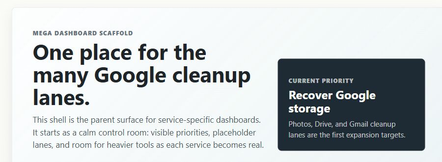

<details>
<summary>Module landing pages</summary>

| Module | Preview |
| --- | --- |
| Health | 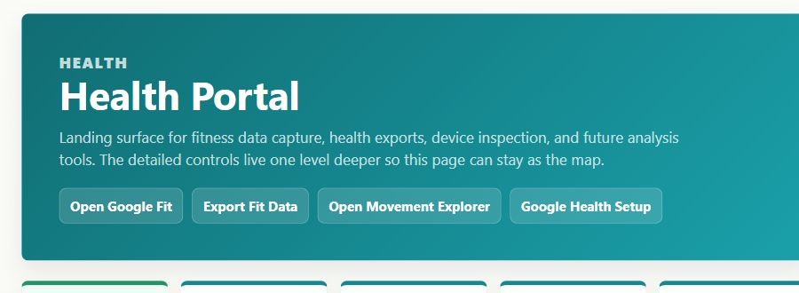 |
| Sound Recorder | 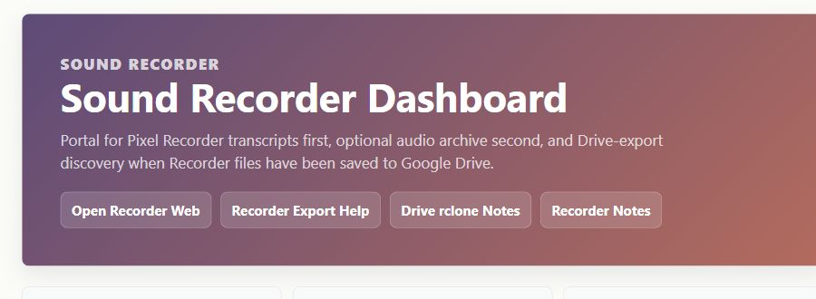 |
| Photos and Video | 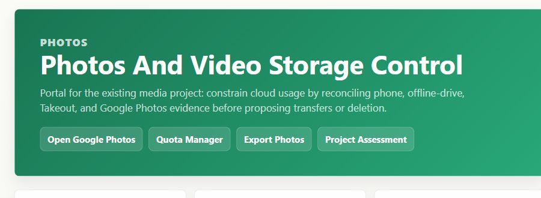 |
| Timeline | 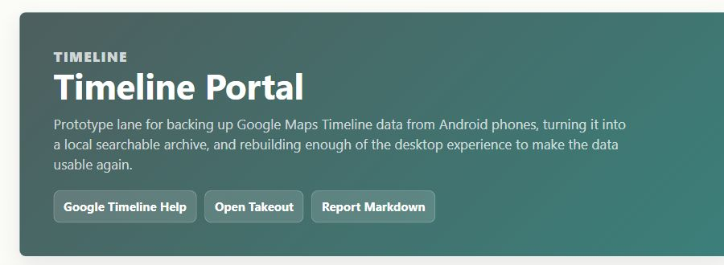 |
| Gmail | 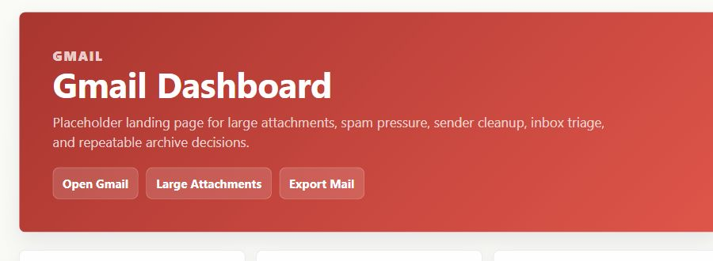 |
| Calendar | 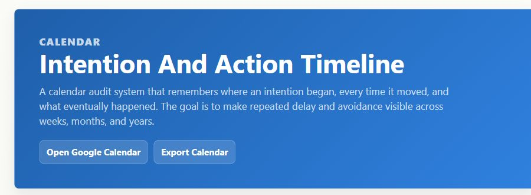 |
| Keep | 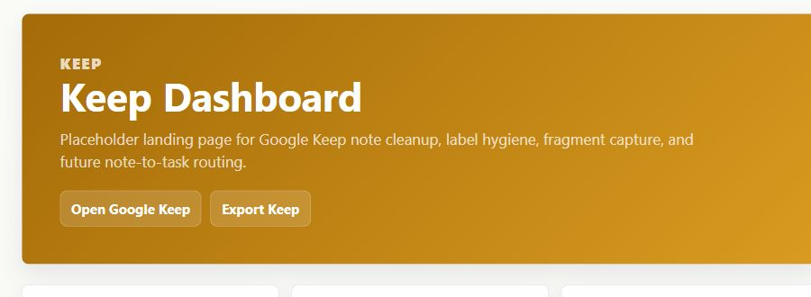 |
| Tasks | 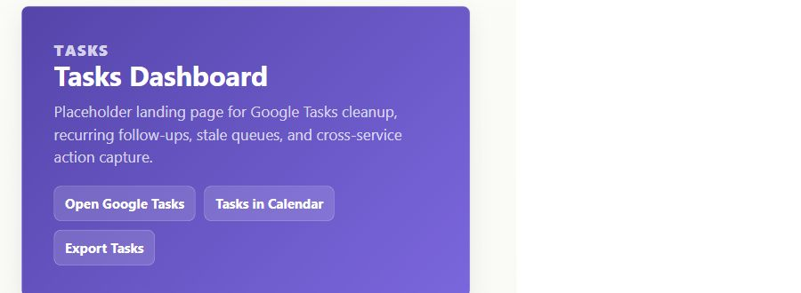 |
| YouTube | 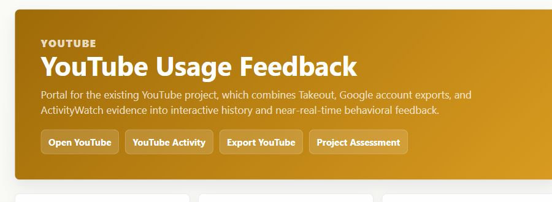 |
| Drive | 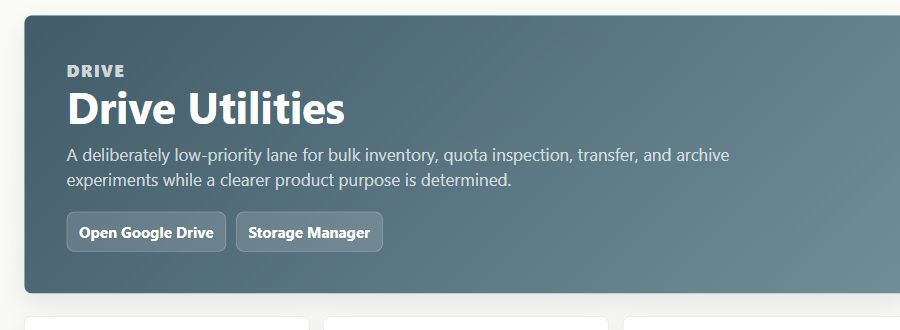 |

</details>

The previews are cropped to public landing-page content and exclude local records, device state, paths, and account data.

## Run

Install the browser-automation dependency once:

```powershell
npm install
```

Double-click `launch-dashboard.cmd`, or run:

```powershell
.\launch-dashboard.ps1
```

The launcher starts the local server and opens `http://127.0.0.1:8787/google/` in Firefox when available.

## Repository Layout

```text
assets/        Browser application code and styling
config/        Generic example configuration only
docs/          Public project and module documentation
scripts/       Local sync, import, analysis, and automation tools
data/          Private generated records; ignored
local/         Private browser profiles and working state; ignored
secrets/       OAuth clients and tokens; ignored
```

## Privacy And Publication

The repository is designed around a public-code/private-data boundary, but the current working history should be audited and sanitized before its first public push. Credentials, health records, location exports, transcripts, audio, account inventories, and private reports must never be committed.

See [PRIVACY.md](PRIVACY.md) for the data boundary. The dashboard also contains a local developer-facing privacy report under **Reports**.

