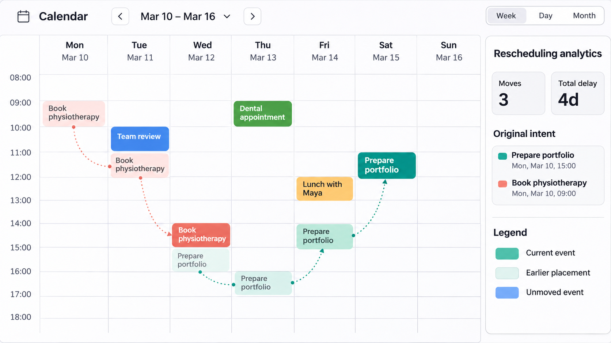

# Calendar Concept

## Status

This module is an idea, not a prototype. Its current implementation is limited to a landing page that records the intended product behavior.

## Core Idea

Conventional calendars preserve the current location of an event but discard most of the story of how it got there. The proposed system gives every intention a stable identity, maintains an immutable audit trail whenever its scheduled time, duration, category, or state changes, and turns that history into useful movement metrics.

The long-term goal is to reveal trends in which *types* of events move, how often they move, how far they move, and whether they are eventually completed, abandoned, or continually deferred. That makes repeated movement of health, career, administrative, social, rest, and custom commitments visible across weeks, months, and years instead of treating each reschedule as an isolated edit.

The working theme is **the tension between intention and action**.

This image is an illustrative product mockup, not an implemented screen. Repeated titles identify one stable intention; translucent placements show where it previously lived, and ordinary events remain single solid blocks.

## Intended Views

- **Placement shadows:** show earlier scheduled positions behind the current event.
- **Movement ledger:** list every reschedule, cancellation, completion, and category change.
- **Delay measures:** calculate move count, accumulated delay, unresolved age, and time from first intention to action.
- **Type comparison:** compare health, career, administration, rest, social, and custom intention categories.
- **Pattern review:** find repeatedly deferred categories across weeks, months, and years.
- **Calendar maintenance:** separately review stale recurring events, duplicates, abandoned calendars, and historical clutter.

## Design Boundary

Google Calendar can remain the operational backbone. This module is intended to overlay its audit, shadow, and analysis layer onto the familiar calendar rather than replace the calendar used for day-to-day scheduling. Necessary rest, health management, and deliberate reprioritization should not automatically be classified as failure; the system must expose evidence without pretending to know the reason for every move.

## First Research Questions

1. Which Google Calendar APIs or local snapshots preserve enough event identity to detect moves reliably?
2. How should an intentional reschedule differ from avoidance, cancellation, or completion?
3. Can recurring events retain useful lineage without producing misleading movement counts?
4. What event categories can be inferred safely, and which require explicit user labels?

## Research

The product direction is informed by research on temporal motivation, intention-action gaps, emotion regulation, prospective memory, implementation intentions, and adaptive goal adjustment. These are overlapping explanations for a behavior pattern, not a diagnosis or a claim that every reschedule is procrastination.

- [Self-directed deadlines, calendar movement, and design implications](self-directed-deadlines-research.md)
