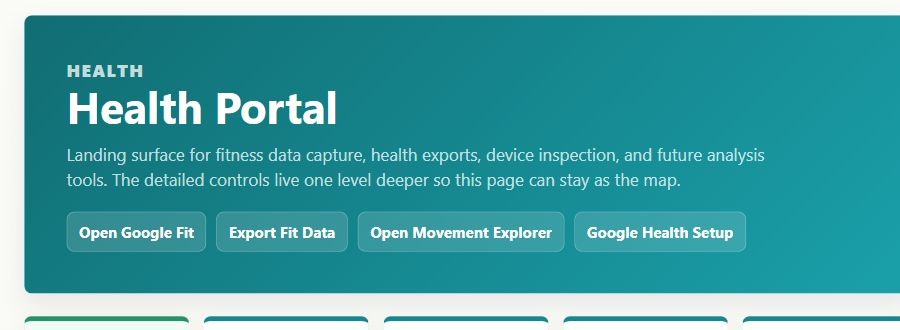

# Health Module



The Health portal connects Google Health account data to local archives and browser-based analysis. The current implementation focuses on Fitbit-compatible Google Health data, paired-device status, movement history, sleep, exercise, heart-rate-derived metrics, and missing-data analysis.

## Start Here

1. Complete [Google Health API setup](google-health-setup.md).
2. Run `node scripts/google_health_oauth.mjs` once to authorize the selected account.
3. Run `node scripts/google_health_sync.mjs` or use **Sync Google Health** in the Movement interface.
4. Open `http://127.0.0.1:8787/google/health/movement/`.

## Data Flow

```text
Google Health API
  -> ignored OAuth credentials and tokens in secrets/
  -> ignored raw and derived records in data/google-health/
  -> local dashboard API
  -> movement, device status, gaps, and reports in the browser
```

The repository contains synchronization and analysis code, not health records. A separate operations guide will document the private data layout and inference boundaries after the workflow is generalized for public use.

## Current Interfaces

- **Movement:** multi-resolution activity visualization, device battery and sync status, gaps, and inferred groupings.
- **API Polling:** synchronization diagnostics and update cadence experiments.
- **ADB Snapshot:** device/package evidence that remains available without private app-database access.
- **Exports:** future Takeout and account-export intake.
- **Health Connect:** future phone-native reader lane.
- **Trends:** future cross-metric and cross-module analysis.

## Important Limits

- Missing records cannot distinguish an uncharged device, off-wrist time, delayed phone synchronization, or an API delivery gap by themselves.
- Unsupported scopes or unsupported device features normally produce empty datasets; they do not add capabilities to a device.
- Movement labels are local heuristics over Google-provided signals and are not clinical classifications.
- Battery and last-sync values represent the most recent paired-device metadata retrieved from Google Health, not a live Bluetooth connection.
