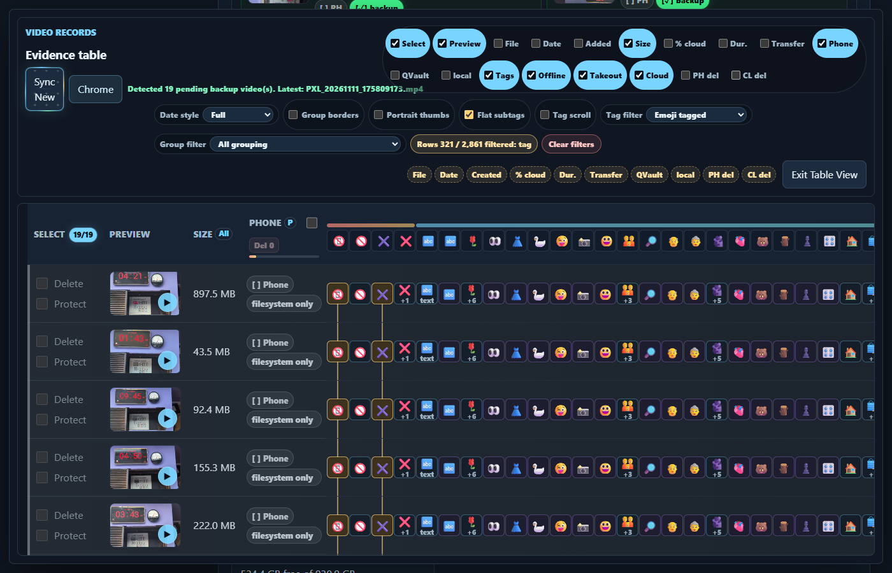
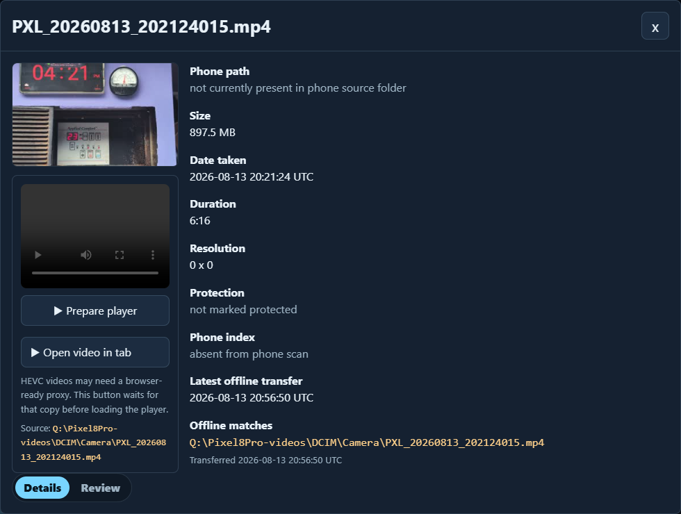

# Photos And Video Project Assessment

## Purpose

The media project helps a user keep Google Photos within a fixed storage limit without losing irreplaceable photos or videos. Its main advantage is batch reasoning: related media can be seen contiguously, reviewed once, and marked across many rows instead of repeatedly finding an item and navigating phone or cloud menus one file at a time. The same review can guide a permanent offline copy and prepare guarded phone or cloud removal queues, reducing both hands-on time and the cognitive effort of remembering what is safe to keep, transfer, or remove.

Visual tags serve two roles. **Operational tags** record intent toward a later action, such as protect, back up, remove from the phone, or propose removal from cloud quota. **Descriptive tags** add reusable subject or context metadata for organization and retrieval. Click-dragging across representative emoji cells makes either kind of classification practical across a contiguous group.

### Illustrative Lifetime Impact

The project's current deduplicated private report provides a useful scale example without publishing its underlying inventory:

- 977 unique files and 52.0 GB backed up;
- 45.8 GB of store-level space reclaimed across phone and cloud removal;
- 373 individual deletion interactions avoided;
- about 1 hour 35 minutes of typical hands-on deletion work estimated to have been replaced by batch processing.

The time figure estimates avoided selection, menu, confirmation, and ordinary UI or network interaction. It is not total project-development or processing time, and the reclaimed totals should not be interpreted as unique-media size because one file can release space from more than one store.

## Existing Capabilities

- Builds an inventory-oriented media dashboard from phone, staging-drive, offline-drive, Google Photos, and Takeout evidence.
- Matches files using names, byte sizes, dates, hashes, and progressively richer similarity evidence.
- Pulls selected Pixel videos into controlled offline destinations and records transfer history.
- Maintains protected-media and deletion-history records for guarded phone cleanup.
- Parses Google Takeout archives and produces reconciliation manifests and coverage reports.
- Builds video similarity groups, location maps, duration caches, and candidate review batches.
- Presents related records contiguously so evidence, thumbnails, duplicates, and intended actions can be compared without repeatedly reopening individual files.
- Supports click-drag emoji tagging across multiple records for rapid operational intent, descriptive classification, grouping, and later batch decisions.
- Converts reviewed operational tags into persistent queues so offline transfer, phone cleanup, and cloud quota cleanup can be applied in batches with verification boundaries.
- Keeps Google Photos cloud reconciliation separate from phone deletion and requires offline evidence before cloud-side deletion is considered.
- Prototypes mobile swipe review, desktop batch review, browser-assisted cloud inspection, and an Android connectivity monitor.

## Current Product Shape

The project is already a family of cooperating tools:

1. **Media dashboard:** evidence, status, maps, groups, and transfer decisions.
2. **Cloud reconciliation:** read-first matching between local evidence and Google Photos.
3. **Media pruner concepts:** mobile intent capture and desktop batch application.
4. **Automation scripts:** Takeout ingestion, matching, thumbnails, similarity, transfer, and guarded deletion.

## Recommended Hub Integration

Do not merge its data store or processing scripts into the Hub yet. Treat it as an independently runnable subsystem and integrate through a small contract:

- a Photos landing page that explains its quota-management purpose;
- launch and status links into the media dashboard and cloud reconciliation interface;
- a compact generated summary containing inventory counts, protected items, unresolved cloud matches, and reclaimable bytes;
- explicit links back to this assessment and the project's own operational documentation.

This keeps high-risk deletion logic beside the evidence and review model while allowing the Hub to become the navigation and status layer.

The Hub's Photos module can now start this existing local application and open it in a new browser tab. This is process-level integration only; the media project continues to own its server and private records.

## Boundary To Preserve

Raw media, Takeout archives, phone inventories, face evidence, location caches, and deletion targets are private operational data. Public screenshots must be selected deliberately and limited to user-approved, non-sensitive examples; an approved representative thumbnail does not make the underlying inventory public.

## Roadmap

- Add an in-browser tag-vocabulary editor for creating, renaming, describing, ordering, and retiring emoji tags. The current vocabulary was largely produced through AI-assisted project prompts; users can apply existing tags in the dashboard, but cannot yet manage the vocabulary there.
- Make operational tags visibly distinct from descriptive metadata and show which queued action, if any, each operational tag will produce.
- Add batch previews that summarize selected file count, unique bytes, affected stores, required offline evidence, and proposed actions before anything destructive runs.
