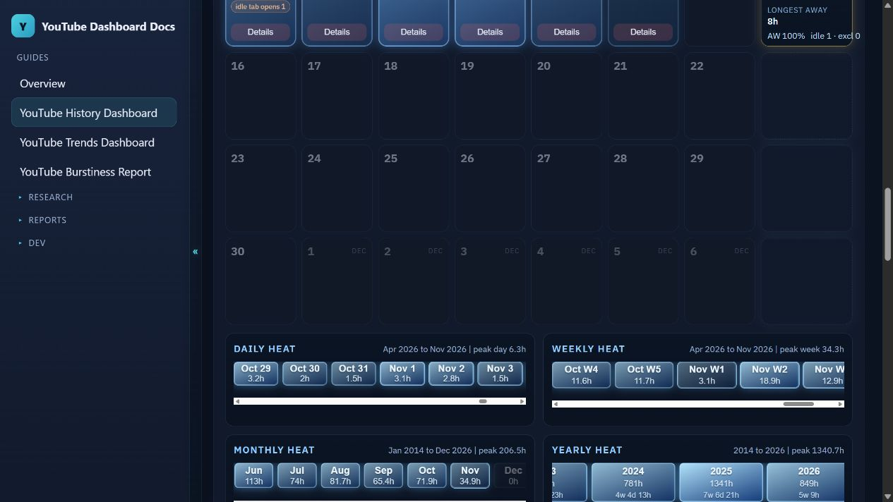
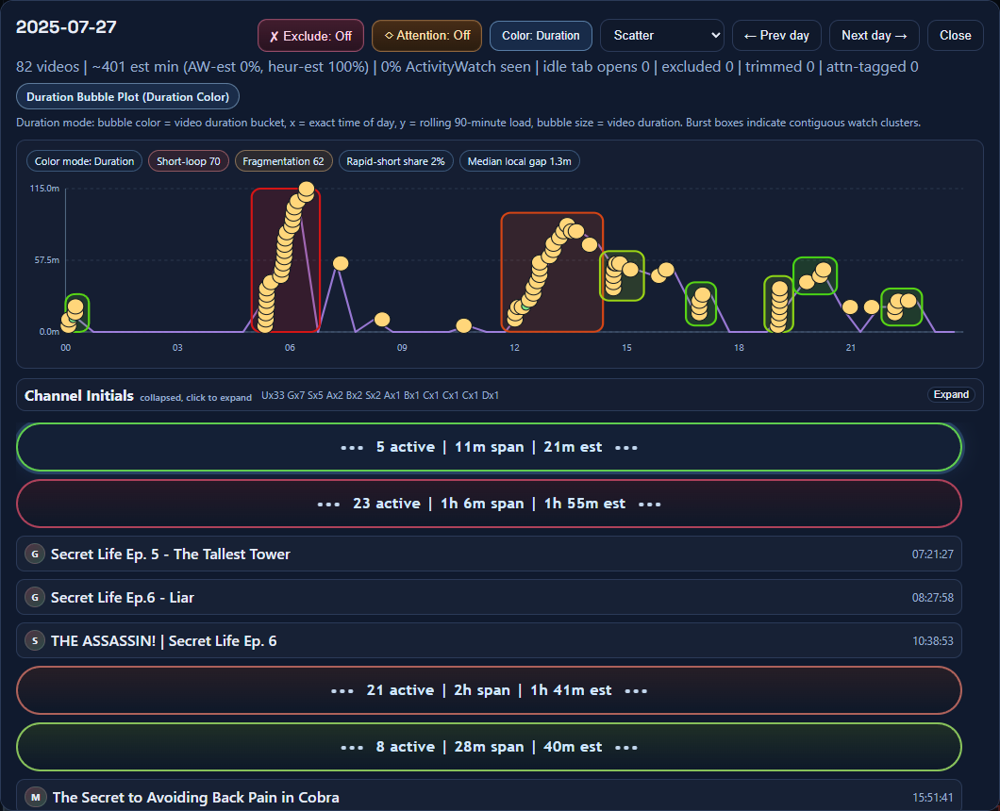
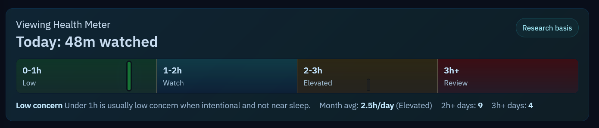
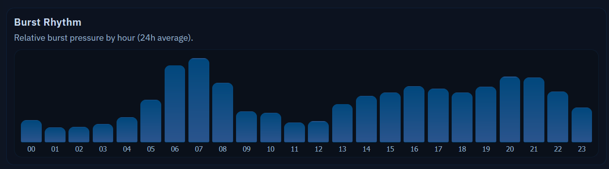
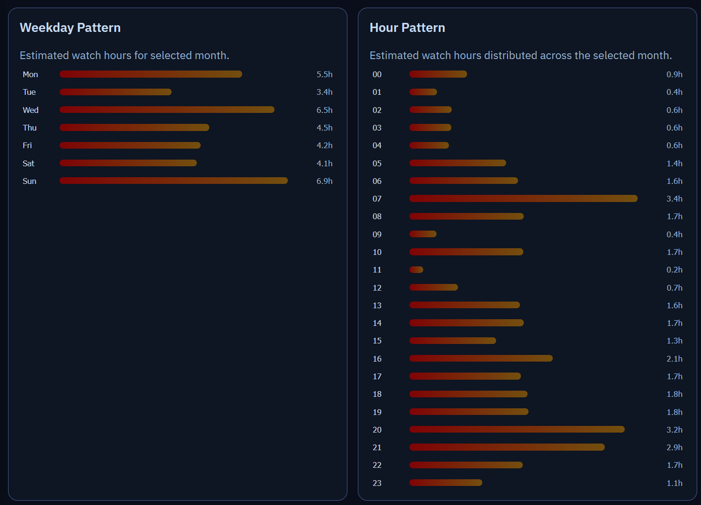
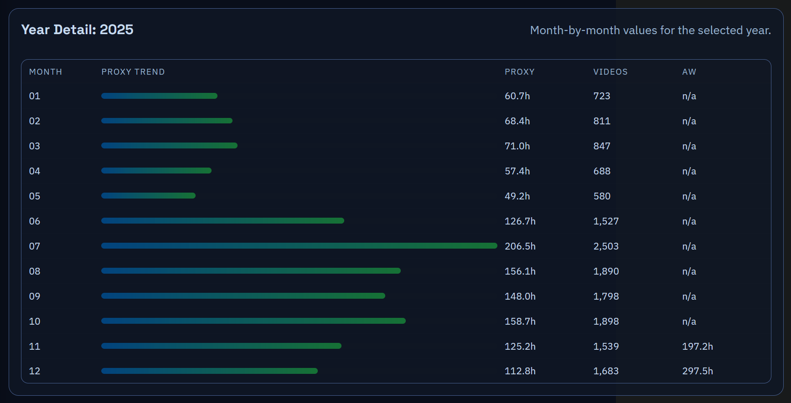
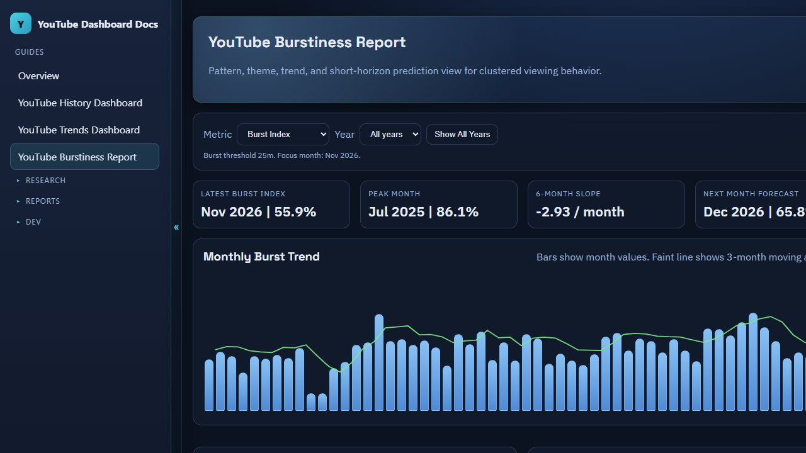

# YouTube Project Assessment

## Purpose

The existing YouTube project converts long-term viewing history and near-real-time browser evidence into user-friendly feedback. Its primary product is behavioral visibility: showing when, how much, and in what patterns YouTube is being used. Calendar cells use stronger color emphasis for heavier viewing days, while compact intraday strips and cluster highlighting reveal when viewing concentrates into contiguous bursts rather than being distributed across the day.

## Existing Capabilities

- Uses enriched Google Takeout watch history as a historical seed and occasional manual snapshot, not as the ongoing update mechanism.
- Pulls optional local ActivityWatch evidence and refreshes it on a schedule.
- Supports Google Data Portability exports as separate account-history evidence where that service is available; these are export jobs, not live playback telemetry.
- Audits overlap among Takeout, Google account exports, and ActivityWatch before canonical merging.
- Presents month navigation, intensity-colored calendar summaries, clickable peak days, and daily, weekly, monthly, and yearly heatmaps.
- Provides drill-down views with direct source links, multiple graph modes, expandable detail groups, and colored outlines around contiguous viewing clusters.
- Measures estimated viewing duration, raw ActivityWatch time, viewing ratios, health-meter bands, burstiness, gaps between sessions, weekday patterns, hourly rhythms, and year-by-year or month-by-month load.
- Includes research and diagnostic views for healthy viewing, short-form use, idle-tab detection, real-time playback evidence, performance, and detail-modal regressions.

## Data Sources And Accuracy

The project intentionally keeps evidence sources distinct:

| Source | Role | Important limit |
| --- | --- | --- |
| Google Takeout | Historical account seed and manual backfill | Snapshot-based; unsuitable for continuous updates |
| ActivityWatch | Local browser URL/title, window-duration, and AFK context | An active YouTube tab does not prove continuous playback; pause, seek, rate, and exact watched seconds are not reliably observed |
| Google Data Portability | Account-side export and cross-device recovery where available | Archive-job workflow, not a live stream, and availability is constrained |
| YouTube Data API | Official video title, channel, and duration metadata | Describes the video, not how much of it was watched |
| Planned browser extension | Precise local player events and watched segments | Must be installed in each participating browser/device |

The current ActivityWatch pull reads ordinary browser event URLs and titles, clips them to non-AFK intervals, and applies a conservative timing proxy. No implemented userscript that rewrites the page title was found in the current repository or the reviewed project handoff. Older design notes discuss a userscript or title bridge, but the current recommendation is a dedicated extension because browser titles cannot reliably represent play, pause, seek, playback rate, tab visibility, or Shorts navigation.

The health meter and fatigue/fragmentation interpretations are behavioral heuristics, not medical measurements. Their value is comparative feedback and trend visibility, with source coverage shown alongside the estimates.

## Current Product Shape

The project already contains a data-build pipeline, local synchronization helper, scheduled refresh path, primary history dashboard, trend views, research pages, and diagnostic reports. It is more mature than the Hub's current YouTube placeholder.

## Additional Analysis Views

The larger views are placed later so the opening remains focused on the calendar, selected-day drilldown, health meter, and compact burst rhythm.

## Recommended Hub Integration

Keep the YouTube project independently runnable and let the Hub act as its portal:

- link to the current dashboard and major analysis views;
- display last refresh time and source freshness from a small generated status file;
- surface a few headline measures such as today's viewing, recent trend, burst pressure, and ActivityWatch availability;
- preserve all detailed calendar, heatmap, and drill-down interactions in the YouTube application;
- defer shared authentication or a combined data store until both projects have stable public contracts.

This approach provides immediate integration value without duplicating a large interface or binding the Hub to the YouTube project's evolving data schema.

The Hub's YouTube module can now start this existing local application and open its history dashboard in a new browser tab. This is process-level integration only; the YouTube project continues to own its server and private records.

## Roadmap

- Build the planned Firefox WebExtension companion as the primary high-precision ongoing source. Capture video load, play, pause, seek, playback-rate change, ended, visibility, unload, Shorts navigation, current position, and duration.
- Convert player events into auditable watched segments, persist raw extension telemetry separately, and merge by video ID plus nearby time without discarding source provenance.
- Post to the local helper when reachable and maintain a bounded offline queue when it is not, with visible connected, paused, last-event, and queued-event states.
- Use extension-measured watched seconds first, ActivityWatch as local context/fallback, and Takeout or account exports for historical and cross-device recovery.
- Report source coverage and differences between ActivityWatch estimates and extension-measured playback before allowing the new source to alter health or burst metrics silently.

## Boundary To Preserve

Watch events, search activity, ActivityWatch records, account exports, and generated behavioral reports are private. Public documentation should describe the mechanics using synthetic examples rather than publishing the user's history.
