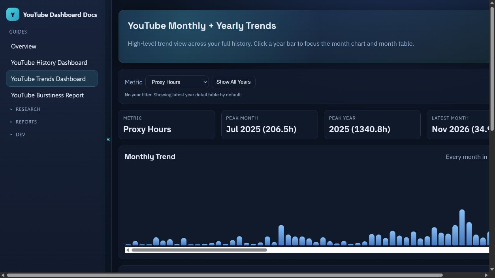

# YouTube Project Assessment

## Purpose

The existing YouTube project converts long-term viewing history and near-real-time browser evidence into user-friendly feedback. Its primary product is behavioral visibility: showing when, how much, and in what patterns YouTube is being used.

## Existing Capabilities

- Ingests enriched Google Takeout watch history.
- Pulls optional local ActivityWatch evidence and refreshes it on a schedule.
- Supports Google Data Portability exports as a separate account-history source.
- Audits overlap among Takeout, Google account exports, and ActivityWatch before canonical merging.
- Presents month navigation, calendar summaries, and daily, weekly, monthly, and yearly heatmaps.
- Provides drill-down views with direct source links and expandable detail groups.
- Measures estimated viewing duration, raw ActivityWatch time, viewing ratios, burstiness, gaps between sessions, and time-of-day rhythms.
- Includes research and diagnostic views for healthy viewing, short-form use, idle-tab detection, real-time playback evidence, performance, and detail-modal regressions.

## Current Product Shape

The project already contains a data-build pipeline, local synchronization helper, scheduled refresh path, primary history dashboard, trend views, research pages, and diagnostic reports. It is more mature than the Hub's current YouTube placeholder.

## Recommended Hub Integration

Keep the YouTube project independently runnable and let the Hub act as its portal:

- link to the current dashboard and major analysis views;
- display last refresh time and source freshness from a small generated status file;
- surface a few headline measures such as today's viewing, recent trend, burst pressure, and ActivityWatch availability;
- preserve all detailed calendar, heatmap, and drill-down interactions in the YouTube application;
- defer shared authentication or a combined data store until both projects have stable public contracts.

This approach provides immediate integration value without duplicating a large interface or binding the Hub to the YouTube project's evolving data schema.

The Hub's YouTube module can now start this existing local application and open its history dashboard in a new browser tab. This is process-level integration only; the YouTube project continues to own its server and private records.

## Boundary To Preserve

Watch events, search activity, ActivityWatch records, account exports, and generated behavioral reports are private. Public documentation should describe the mechanics using synthetic examples rather than publishing the user's history.
