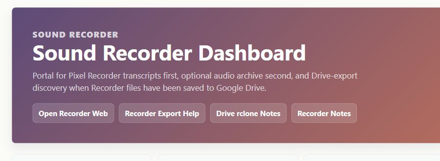

# Sound Recorder Module



The Sound Recorder portal treats transcripts as the primary archive and audio as optional large content. Recorder Web is authoritative for cloud identity, current title, recorded date, duration, and official transcript export; Drive and phone/ADB workflows remain segregated supplements.

## Source Priority

1. **Recorder Web:** stable cloud ID, current metadata, and official text export.
2. **Manual browser downloads:** explicit exports collected from the browser Downloads folder.
3. **Google Drive:** recordings or transcripts intentionally saved to Drive.
4. **Pixel and ADB:** offline fallback driven through Recorder's share interface.

Web metadata wins when sources disagree. Lower-priority files are retained for comparison until reconciliation is validated; the application does not silently delete them.

## Cloud Workflow

1. **Refresh Cloud Inventory** opens Recorder Web with a dedicated ignored browser profile and inventories IDs and visible metadata.
2. **Sync Missing Transcripts** exports each missing official `.txt` transcript.
3. The private manifest records ID, title, date label, duration, hash, byte count, and local path.
4. Repeat runs skip archived IDs and reconcile cloud title changes by stable ID.

Inventory and transcript export cannot run simultaneously because they share one browser profile. Both are interruptible; completed downloads remain valid.

## Local Data Boundary

```text
data/sound-recorder/                 Private catalogs, manifests, statuses, and transcripts
local/recorder-web/chrome-profile/  Private Recorder browser session
<external audio archive>/           Optional large audio storage
```

All transcript text, audio, screenshots, browser credentials, recording titles, IDs, dates, and inventories are private and must remain ignored.

## Phone Fallback

Normal ADB cannot read Recorder's private application database. The fallback automates the visible share/export flow, saves public exports through the phone's file interface, and pulls those exports into the private local archive. Phone-derived names and dates are less reliable than Recorder Web metadata.

The fallback is useful during internet or Recorder Web downtime, but it is not the primary ingestion method.

## Limitations

- Recorder Web has no supported public bulk-download API; the cloud pipeline is browser automation and may require selector maintenance.
- Some recordings have no transcript export.
- Audio is not downloaded by the transcript pipeline unless a separate explicit workflow requests it.
- Renaming Recorder Web titles requires the dedicated profile to be signed in and idle.
