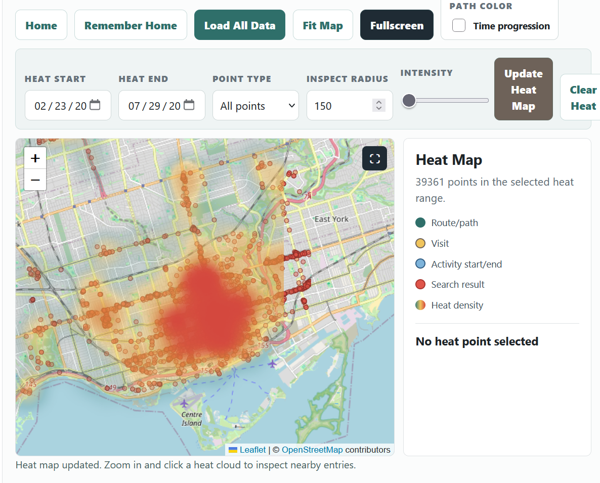

# Timeline Module

## Purpose

Google Maps Timeline is now primarily phone-held data. This module creates a central PC archive from per-phone exports and restores interactive map browsing, date navigation, place inspection, and area search without requiring the source phone to remain connected.

## Implemented Interface

- Imports Android Timeline JSON into compact local point and day indexes.
- Browses individual days on OpenStreetMap, humanitarian, and CARTO base maps.
- Loads the complete local point archive without replacing the current zoom unexpectedly.
- Filters heat maps by date range and point type.
- Exposes nearby entries when a heat cloud or visible point is selected.
- Colors routes by time progression and groups repeated places.
- Provides month, hour, place, and coverage summaries.
- Supports remembered home position, map fitting, and multi-stage fullscreen modes.

## Data Model

Each phone export remains a distinct source until evidence shows that two corpuses are equivalent. Raw exports and generated local indexes are private; the public repository contains only the browser and import tooling.

## Direction

The long-term goal is a device-independent personal location archive with reliable merging, address correlation, area-and-date queries, and a desktop map experience that is not constrained by Google's phone-only Timeline interface.
